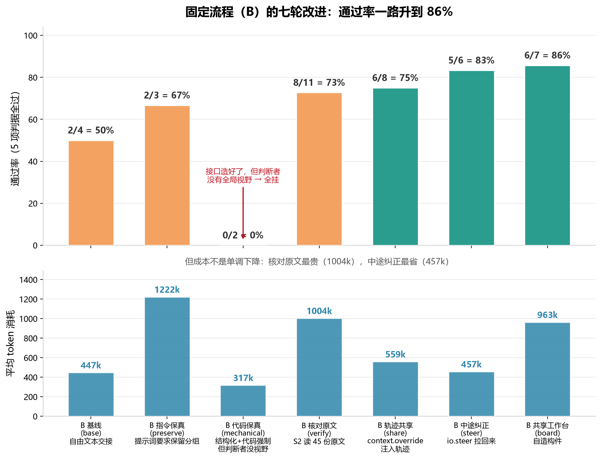
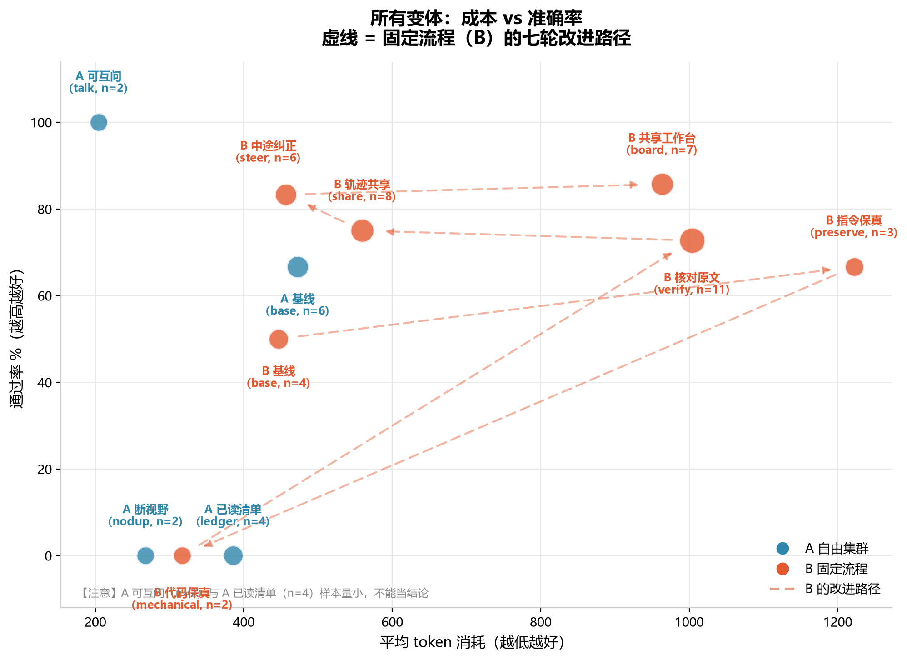
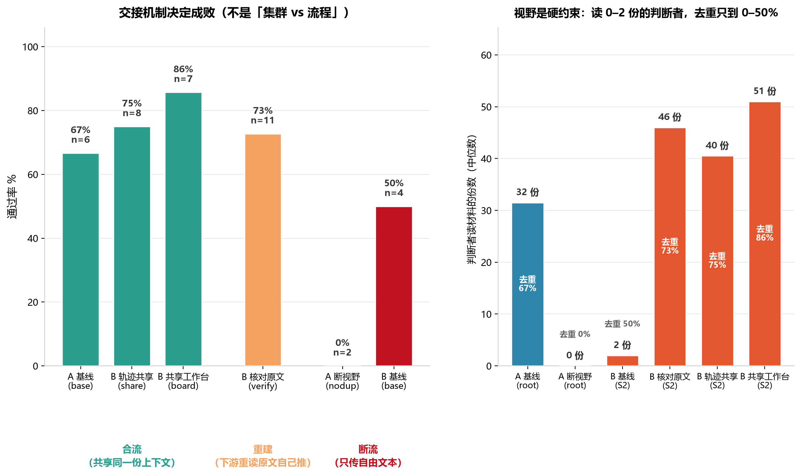
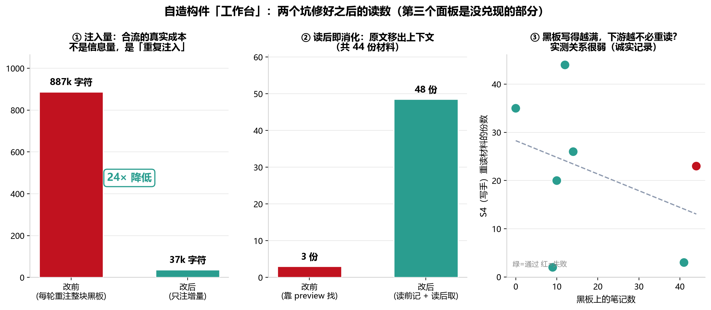
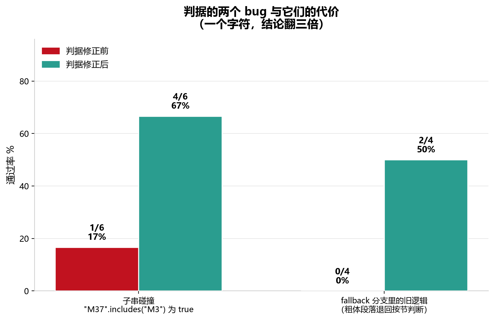
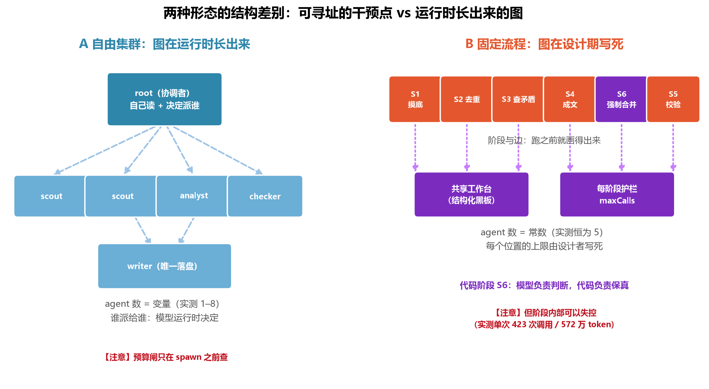
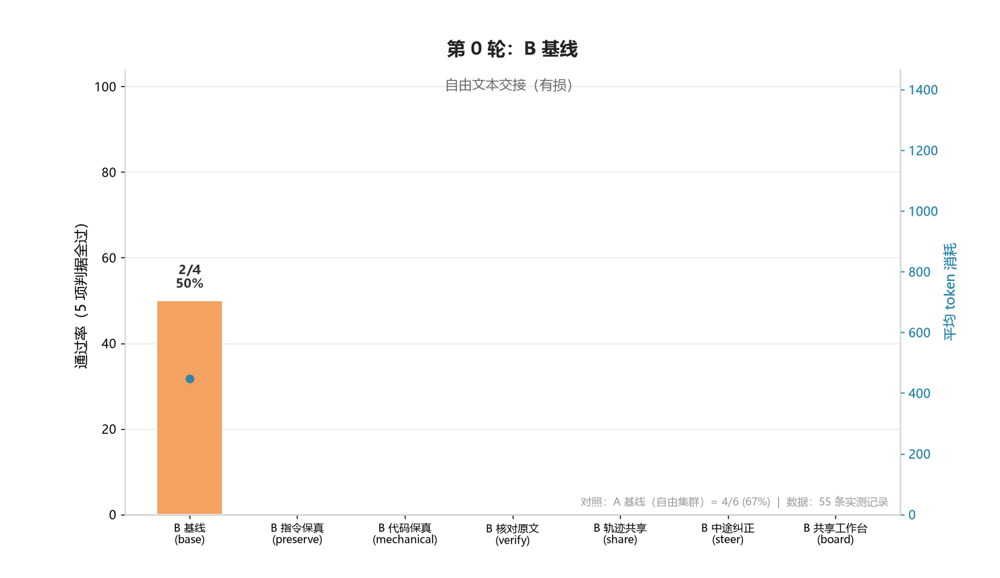

# 自由集群 vs 固定流程：实验报告（图文版）

> 本报告基于 **55 条实测运行记录**（`demom/runs/*.jsonl`），全部数据可复现。
> 图表由 `make_figs.py` / `make_anim.py` 从 `data.json` 生成；`data.json` 由 `extract.mjs`
> 用**当前判据**重判全部记录得到 —— **判据改过之后不需要重跑实验**。
>
> 详细版：[`研究记录.md`](../研究记录.md)（数据篇）· [`修改方法经验总结.md`](../修改方法经验总结.md)（分析篇）

---

## 〇、先看这张表：所有变体叫什么、是什么意思

报告里出现的每个变体名，都是「**在上一版的基础上，只改了一件事**」。括号里是代码里的代号
（对应 JSONL 的 `variant` 字段，方便查原始数据）。

### A 臂 = 自由集群（谁干什么，模型运行时自己决定）

| 中文名 | 代号 | 到底改了什么 |
|---|---|---|
| **A 基线** | `base` | 什么都不改。协调者（root）**可以自己读全部材料**，也可以派活给花名册里的角色 |
| **A 断视野** | `nodup` | **把协调者的 `read` 工具拿掉** —— 它自己看不到材料了，只能靠子 agent 交回来的文字。<br>目的：验证「协调者自己读材料」到底是浪费还是必需 |
| **A 可互问** | `talk` | 给每个 agent 装上「通讯录 + 直接提问」两个工具（`peers` / `ask`），<br>并让派活时**把子 agent 的完整思考轨迹一并交回** |
| **A 已读清单** | `ledger` | 给协调者装一个**外部工作台**：它每读过一份材料，就把标题记进一份清单，<br>每轮都注入给它 —— 相当于「不用脑子记的备忘录」 |

### B 臂 = 固定流程（谁干什么，设计者跑之前就写死）

固定流程的骨架是 5 个阶段，**始终不变**：

```
S1 摸底  →  S2 去重 ‖ S3 查矛盾  →  S4 成文  →  S5 校验
（读材料）   （判定重复） （判定矛盾）  （写报告）  （核查）
```

各变体就是在**这个骨架的某个位置上**改一件事：

| 中文名 | 代号 | 到底改了什么 |
|---|---|---|
| **B 基线** | `base` | 什么都不改。阶段之间靠 `draft/` 目录里的**自由文本**交接 |
| **B 指令保真** | `preserve` | 给写手（S4）加一句话：「**保留 S2 判定的合并分组**，<br>不要把同一组的材料拆成多条」。靠**提示词**要求保真 |
| **B 代码保真** | `mechanical` | 两处改动：① S2 把分组落成**结构化 JSON**；<br>② 在 S4 之后**插入一个纯代码阶段 S6**，用代码强制把拆开的组并回去 |
| **B 核对原文** | `verify` | 给 S2、S3 装上 `list_corpus` + `read`，并**明确要求它们拿原始材料逐组核对**，<br>而不是只看 S1 写的摘要 |
| **B 轨迹共享** | `share` | 用 `context.override` 把上游 agent 的**真实上下文轨迹**（读过什么、怎么想的）<br>直接注入下游 —— 下游不用重读文件 |
| **B 中途纠正** | `steer` | 阶段跑超量时，不再直接中止，而是用 `io.steer` **插一句话把它拉回来**<br>（「别读了，把已知的结论写下来」），并给它一段余量 |
| **B 共享工作台** | `board` | **自造构件**：所有阶段共用一块结构化黑板（每轮注入），<br>并且「写进黑板后，原文就被移出上下文」 |

> **命名规律**：A 的变体名说的是「**协调者身上动了什么**」，B 的变体名说的是「**加了什么机制**」。
> `base` 在两边都表示「该臂的基线，什么都不改」。

---

## 摘要

**实验问的是：同一个任务，交给「自由集群」和「固定流程」两种形态，哪个做得更好？**

答案经过三次修正，最终不是「哪个形态更好」，而是：

> **形态不是自变量，「交接机制」才是。**
> **合流**（判断与执行共享同一份上下文）> **重建**（下游重读原文自己推）> **断流**（只传自由文本）。

改进后的固定流程达到 **86% 通过率**（自由集群基线 67%），但更重要的是**为什么**：

| 发现 | 一句话 |
|---|---|
| **交接机制决定成败** | 集群的失败与流程的失败**机制完全相同** —— 都是「判断者看不见原始材料 + 自由文本交接」 |
| **「重复读」不是浪费** | 信息没有别的渠道时，重读**就是**信息传递本身。把它砍掉 → 0/2 |
| **能力给了，模型不会自己用** | 给集群挂上双向通信工具，**一次都没被调用**（写了最小实验验证工具确实可用） |
| **判据错了 6 次** | 每次都是「不可能的通过率」暴露出来的；最狠的一个字符让结论翻三倍 |

---

## 1. 实验设置

两条对照臂，**同一个任务 T**、同一个模型、同一份语料、同一套判据：

| | A 自由集群 | B 固定流程 |
|---|---|---|
| 谁决定怎么做 | **模型运行时决定** | **设计者写死** |
| agent 数 | 变量（实测 1–8） | 常数（恒为 5） |
| 阶段与边 | 运行时长出来 | 跑之前就画得出来 |

**任务 T**：给 44 份材料，产出 `report.md`，满足 5 项判据 ——
覆盖 5 个主题、**去重**（同一件事只算一条）、**矛盾成对**、**无编造编号**、**不采信干扰材料**。

**为什么难**：去重需要**跨材料比较**，即需要全局视野。

---

## 2. 固定流程（B）的七轮改进



**这张图是全文的主线。** 七轮改进，通过率从 50% 爬到 86%：

| 轮次 | 改了什么 | 结果 |
|---|---|---|
| **B 基线** | 自由文本交接 | 2/4（50%） |
| **B 指令保真** | 提示词要求写手保留上游的合并分组 | 2/3（67%）—— 有效但不可靠 |
| **B 代码保真** | 分组落成 JSON + 纯代码阶段强制合并 | **0/2（0%）** |
| **B 核对原文** | 让 S2 读 45 份原文再判断 | 8/11（73%） |
| **B 轨迹共享** | 把上游上下文注入下游 | 6/8（75%） |
| **B 中途纠正** | 把要中止的阶段拉回来 | 5/6（83%） |
| **B 共享工作台** | 自造构件：结构化黑板 + 读后即消化 | **6/7（86%）** |

**「B 代码保真」那个 0% 是最有价值的一次失败。**

它做的事听起来完全正确：把 S2 的分组落成结构化 JSON，再插一个**纯代码阶段**强制合并。
离线拿 24 份历史报告验证过这个机制：**修好 8 份、弄坏 0 份**。机制没问题。

**但整体 0/2 —— 因为 S2 给的分组本身就是错的：**

> S2 写的是「M1、M7 是同一件事」，真值是「M3、M7」。
> 而 S2 自己交代了原因：「原始材料 **不在可访问路径**，判定依据为 S1-摸底」。

查下来是个设计缺口：S2 的工具只有 `[read, note]`，而语料文件名是 `M3-压缩不如裁剪省.md`
—— 它**连「列出有哪些文件」的工具都没有**，根本找不到原文。**它只能看着摘要做判断。**

**所以第 4 轮（B 核对原文）只改一件事：给做判断的人全局视野。** 结果 8/11。

> **代码能保证「你说的我照做」，保证不了「你说的对」。** 视野和保真必须同时满足。

### 成本：不是单调下降



**这张图揭示了改进的真实代价结构**：

- **B 核对原文**（重读原文）**最贵**（1004k）—— 因为它用**重复劳动**买视野
- **B 轨迹共享** **同样准，便宜一半**（559k）
- **B 中途纠正** **最省**（457k）且准确率 83%
- **B 共享工作台** **准确率最高**（86%）但不是最便宜（963k）

**右上角是「又准又贵」，左上角才是目标。** 虚线是 B 的改进路径。

> ⚠️ 注意：**A 可互问**（n=2）和 **A 已读清单**（n=4）样本量小，不能当结论。

---

## 3. 核心发现：交接机制决定成败



**左图**：把 11 个变体按「下游怎么拿到上游的信息」重新分组，规律立刻出来了 ——

| 做法 | 谁在用 | 通过率 |
|---|---|---|
| **合流**（共享同一份上下文） | **A 基线**（判断和执行不分家）· **B 轨迹共享**（注入轨迹）· **B 共享工作台**（黑板） | **67% / 75% / 86%** |
| **重建**（下游重读原文自己推） | **B 核对原文** | 73% |
| **断流**（只传自由文本） | **A 断视野** · **B 基线** | **0% / 50%** |

**右图是最硬的证据**：判断者读了多少材料，直接决定了去重成绩。

| 判断者 | 读材料（中位数） | 去重通过率 |
|---|---|---|
| **A 断视野** 的协调者 | **0 份** | **0%** |
| **B 基线** 的 S2 | **2 份** | **50%** |
| **A 基线** 的协调者 | 32 份 | 67% |
| **B 轨迹共享** 的 S2 | 40 份 | 75% |
| **B 核对原文** 的 S2 | 46 份 | 73% |
| **B 共享工作台** 的 S2 | 51 份 | 86% |

> **读 0–2 份的判断者，去重只到 0–50%。** 这是信息论上的硬约束，不是提示词写得好不好的问题。

### 两个形态的失败是同一个失败

**A 断视野（集群）和 B 基线（流程）是同一种病**：

- A 断视野：把协调者的 `read` 拿掉（省了 43% token），它就只能靠子 agent 的自由文本
- B 基线：判断者（S2）只能看 S1 写的摘要

**失败机制一模一样** —— 判断者看不见原始材料 + 自由文本交接。
这直接说明：**「集群 vs 流程」不是根因。**

### 而 A 基线和 B 轨迹共享是同一种成功的两种实现

- **A 基线靠「不分离」**：判断和执行在同一个 agent 里，压根不传
- **B 轨迹共享靠「送过去」**：把上游的上下文轨迹直接注入下游

**两者都是「合流」。** 这就是为什么它们都有效。

### 一个推翻我自己早期判断的发现

**B 核对原文**为什么能到 73%？因为我让 S2 **重读 45 份原始材料** —— 但那些材料 S1 刚读过。
**这是重复劳动。**

而我最早在 A 里把同样的东西叫「重复劳动」，还想砍掉（就是 **A 断视野**）—— 结果 **0/2**。

> **当信息没有别的传递渠道时，「重新读一遍」就是信息传递本身。**
> 它不是浪费，是**用算力买信息**。**B 轨迹共享**的贡献是：同样的信息，可以不用重读就传过去。

---

## 4. 自造构件：工作台（Workbench）

前几轮都是在**试库的功能**。这一轮反过来：**从分析结论出发，用底层原语造一个东西。**
（就是 **B 共享工作台** 这个变体，代码在 `bench/workbench.ts`）



**它要解决的交集问题**：交接必须有全局视野（否则失败），但合流很贵（原始材料被反复搬运）。

**做法**：

```
① 黑板      所有 agent 共享一份结构化状态（材料要点 / 重复组 / 矛盾对 / 成文条目）
② 合流      每轮通过 context.override 注入每一个 agent —— 但注的是提炼过的结论，不是原文
③ 读后即消化 用 post 把要点写进黑板后，代码把那条原始 read 的条目 erase 掉
④ 代码守不变量 写入时就校验：编号必须真实、重复组≥2 个成员、矛盾必须正好两个编号
```

**④ 与「B 代码保真」里的代码阶段是同一条分工：模型负责判断，代码负责保真。**

### 造的过程中踩的两个坑（都是实测发现的）

**坑 1：每轮重注整个黑板 → 成本爆炸**

```
第一版：总注入量 887k 字符（黑板本身才几 k，但每个 agent 每轮都重注）→ 1.09M–1.56M token
修法：黑板改成只追加的事件日志，每人只收自己没看过的增量
结果：887k → 37k 字符（24× 降低）
```

> **这才是「合流」真正的成本所在：不是信息量，是重复注入。**
> 任何共享上下文的做法（包括 B 轨迹共享）都会撞到它。

**坑 2：靠 `preview` 定位要消化的条目 → 44 份只消化了 3 份**

原因：`preview` 是那条消息的**正文（文件内容）**，而文件内容不以自己的编号开头。
修法：`tool_call` 时记「要读谁」，`tool_result` 之后取最新 toolResult 条目，两步接起来。
**结果：消化数 3 → 48 份。**

### 第三个面板：没兑现的部分（诚实记录）

我原本想证明「黑板写得越满，下游越不必重读」。**实测关系很弱** ——
`笔记=41 → 写手只读 3 次`，但 `笔记=12 → 写手读了 44 次`。

**这个构件目前只兑现了一半承诺。** 记在这里，不藏。

---

## 5. 方法学：判据错了六次



**每一次都是「不可能的通过率」暴露出来的**，不是我先怀疑判据：

| # | 症状 | 真因 |
|---|---|---|
| 1 | 去重 **0/20**（所有组、两边全灭） | 判据把「合并成一行」的**正确做法**判成了错误 |
| 2 | 干扰材料「被盗用」，但模型明明处理对了 | 把「提到 M11 说它无关」也算成采信 |
| 3 | 一个**合并得完美**的报告被判失败 | **子串匹配**：`"M37".includes("M3")` 为 true |
| 4 | 正确处理了干扰项的报告被判越界 | 排除声明带了一行「依据：…」 |
| 5 | 合并得很好的报告又被判没去重 | 报告用**粗体段落**而非 bullet → 退回第 1 次的旧逻辑 |
| 6 | 又一份排除声明被判越界 | 排除声明直接附在最后一个主题节末尾 |

**上图是其中两个 bug 的代价**：一个字符让 **A 臂**从 1/6 变 4/6；
一个 fallback 分支让 **B 基线**从 0/4 变 2/4。

> **可复用的教训**：
> ① 一个 0% 或 100% 的通过率，**先怀疑判据，别怀疑模型**；
> ② 判据必须能拿旧数据重判（存产物全文，而不是只存分数）——
> 六次修正**一分钱没花、一次没重跑**（重跑一次要 10–50 分钟）。

另有两类**非判据**的 bug：

- **任务文本路径歧义**：我写的是「写出 `work/report.md`」，而工作目录**就是** `work/`。
  模型有时写到 `work/work/report.md`，被记成「产物不存在」——**看起来像能力失败，实际是我的 bug**。
- **`agent.usage` 不是实时读数**：它在一次运行**结算之后**才累加。我拿它做实时预算护栏，
  **从来没触发过** —— 拿了一个不会动的读数。（库层缺口，按纪律只记录、未改 `src/`。）

---

## 6. 两种形态的结构差别



**A 的图在运行时长出来**：协调者自己读 + 决定派谁，agent 数实测 1–8。

**B 的图在设计期写死**：6 个阶段，agent 数恒为 5。

这张图对应分析篇里最本质的一条：

> **流程的优势不是「阶段固定」，而是设计者在设计期就拥有「可寻址的干预点」。**
> 集群的每一步由模型在运行期决定 —— **设计者手里没有地址。**

具体到「修合并丢失」这件事：

- 在 B 里我能说：**在 S4 之后插一段代码** —— 这是一个坐标，跑一百次都在同一位置
- 在 A 里我只能说：「让协调者写之前先检查一遍」—— 但它什么时候写、检查自己做还是派人，
  全是运行期决定的

**同一个修复意图，在 B 里是一个坐标，在 A 里是一句祈祷。**

### 但两种形态的失败边界是反的

- **流程**：失败更局部、更好修（改一行就见效），但**无界** ——
  实测 S5 校验阶段单次 **423 次调用 / 572 万 token**，而「阶段数固定」让人以为它不会失控
- **集群**：失败更弥散，但**有界** —— 至少有个预算闸（虽然只在派活之前拦）

**「结构固定」不等于「代价有界」。**

---

## 7. 动态演示



每帧一轮改进，柱状是累计到该轮的通过率，蓝线是成本。

---

## 8. 局限（必须一起看）

1. **A 臂没有被公平改进（头号问题）**。B 改了四轮，A 只改过三次（两次是负结果）。
   所以「B 86% vs A 67%」**不是形态对比**，是「改过的 vs 没改的」。
2. **样本小且不对称**：A 基线 6 / B 核对原文 11 / B 轨迹共享 8 / B 中途纠正 6 /
   B 共享工作台 7 / A 可互问 2 / A 已读清单 4。**83% vs 67% 这类差距在噪声内。**
3. **判据被调过 6 次**，存在研究者自由度风险。辩护是「六次修正都指向同一族语义错误，
   且对称施加于两边（每次改完重判全部 55 条）」—— 但这是**我自己给自己发的合格证**。
4. **只有一个模型、一个任务**。文献普遍发现模型越强、多 agent 优势越小；
   换顺序规划类任务结论可能反转。
5. **语料有瑕疵**：M1 的正文意外地与 M3≡M7 组重叠，让这一组的「正确答案」不唯一。
6. **工作台的第三个承诺没兑现**（§4 末尾）。
7. **`agent.usage` 不是实时读数**（库层缺口，只记录未修）。

---

## 9. 三条最值钱的结论

1. **形态不是自变量，交接机制才是。**
   合流 > 重建 > 断流。证据：**A 断视野**与**B 基线**是**同一种失败**；
   **A 基线**与**B 轨迹共享**是**同一种成功的两种实现**。

2. **「重复读」不是浪费，是信息传递本身。**
   信息没有别的渠道时，重读就是传递 —— 砍掉它 0/2，用轨迹共享替代它更便宜。

3. **能力给了，模型不会自己用。**
   给集群挂上双向通信工具（`peers` / `ask`），**一次都没被调用**。
   与最初的派活工具同一模式 —— **库给机制，用不用是策略层的事**。

---

## 附：复现

```bash
node demom/bench/prep.ts                                    # 铺现场
node demom/labA-cluster/run.ts --repeat 5 --tag main        # A 基线
node demom/labB-workflow/run.ts --variant board --repeat 3  # B 共享工作台
node demom/bench/variants.ts                                # 所有变体一张表（用当前判据重判）

# 重画本报告的全部图
node demom/report/extract.mjs
python demom/report/make_figs.py
python demom/report/make_anim.py
```
